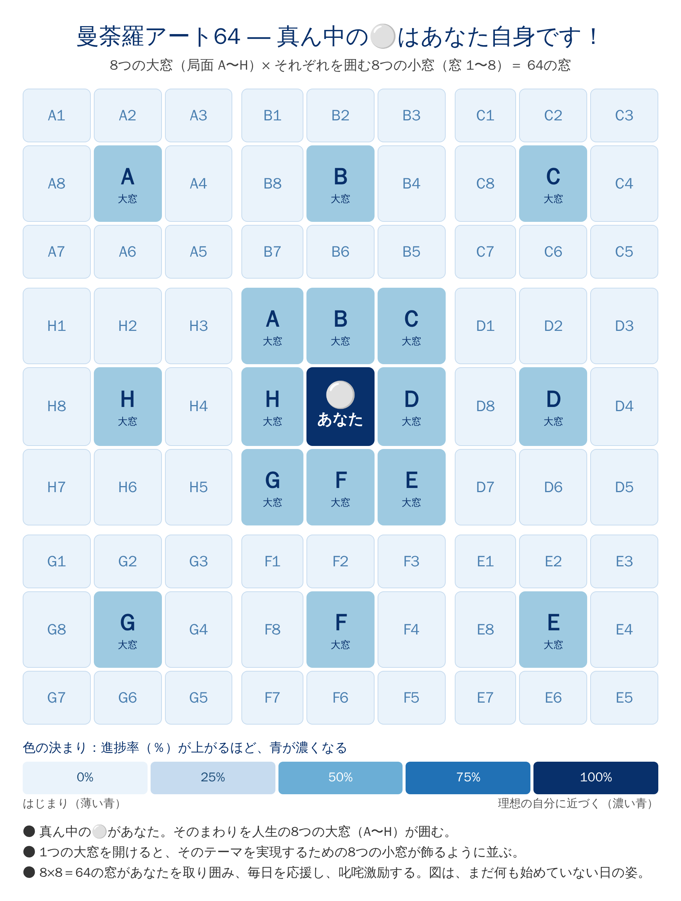
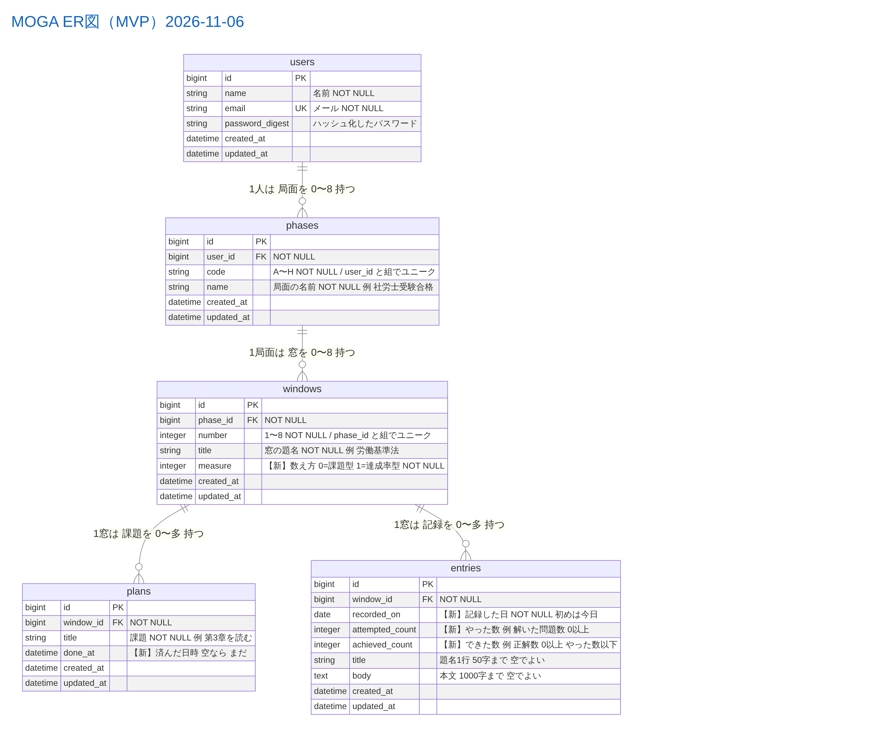

# 曼荼羅アート64（脳内情報図書館64・自己実現に向けた目標管理・達成のためのオープンWindows64）
## ― MOGA：真ん中の⚪はあなた自身です！

> **はじめに：** 2025年3月末、65歳の定年退職を機に「第3の人生」を歩み始めた。私の人生を、このままでは終わらせたくない！ 厚生労働省（ハローワーク）のキャリア形成リスキリング推進事業のひとつ「人生100年時代への挑戦 ミドル・シニア いきいきキャリアプラン策定塾（人生戦略検討塾）」で考えてきたことを、毎日の実践に生かす道具として、アプリケーションを作れないだろうか！？

## 1. サービス概要

- MOGA は、**成長する進捗管理の記録簿** である。自分の中にあるものを可視化する。可視化とは、すなわち第一に **数値化** である
- しくみ：人生を **8つの局面** に分け、局面ごとに8つの窓を置く。窓ごとに「済み ÷ 予定」で進捗率（％）を出し、8×8の一覧を青の濃淡で塗り分ける。そうして自分の **現在地と現在値** を数字で知り、**自分を客観的に見つめる**。合言葉は「**着眼大局、着手小局**」。大窓で人生全体を大きく見渡し、窓の予定で今日の小さな一歩に手をつける
- 誰の、どんな課題を、どう解決するか：**定年後に第3の人生を始めた人** が、「明日どうなるか分からない」不安の中でも、**8つの局面・64の窓を％で見える化** して自分の現在地と現在値を客観的に知り、**今日の小さな一歩を決めて、着実に踏み出せる** ようにする。高校の倫理社会の最後の授業で先生が贈ってくださった「**君の明日は今日の君ではない**」（日々前進あるのみ）という言葉を、毎日の数字で確かめていくアプリである
- 「64」にこめた意味：一つは、65歳の定年退職の1年前、64歳のときから本格的に意識し、手元に置きたいと願ったアプリであること。もう一つは、人生の8つの窓を最低でも持ち、毎日開けて昨日・今日・明日の自分の姿と成長を見続けること。1つの窓を開けると、そのテーマを実現するための8つの小窓が飾るように並ぶ。**8×8＝64の窓があなたを取り囲み、毎日を応援し、叱咤激励する**（このREADMEでは、大きな窓を「局面」、小窓を「窓」と呼ぶ）
- 8つの局面（私の場合）：A 社労士受験／B 地域防災／C 金融ジェロントロジー（荻田家の資産管理）／D 健康と運動脳／E 芸術と文芸／F 100歳までの時間管理（司令塔）／G 美術／H RUNTEQ卒業とIT貢献
- 名前の由来：MOGA ＝ **Make Ogita Great Again**（私を、再び偉大に！）。曼荼羅の **真ん中の⚪は、私 OGITA の O であり、使うあなた自身でもある**。だから、あなたにとっての MOGA は「**あなたを、再び偉大に！**」。私自身のためのアプリであり、あなたにも使えるアプリにする

---

## 2. このアイデアはどこから生まれたか

### 2-1. きっかけとなった体験・感情

- **いつ**：2025年3月末に定年退職し、第3の人生をスタートさせたとき
- **どんな状況で**：
  - 冒頭の「人生戦略検討塾」に通い、キャリアの振り返り、リスキリングの方向性、マネープランについて学んだ。多様なキャリアデザインを組み立てるため、個別のコンサルティングも合計3回受けた
  - 塾に通いながら、次の3冊を半年かけて熟読した
    - リンダ・グラットン『WORK SHIFT』
    - リンダ・グラットン『LIFE SHIFT2 100年時代の行動戦略』
    - 田中研之輔『プロティアン 70歳まで第一線で働き続ける最強のキャリア資本術』（プロティアン＝変幻自在のキャリア）
  - その結果、このアイデアが生まれた
- **どんな気持ちになったか**：
  - もちろん、このままでは終わらない
  - 66歳でも、まだまだ挑戦する力を持続させたい。地元でも地域のリーダーでありたい
  - そのために、冷静沈着に自分を見つめ、これからどう生きるかを決めるための「自己診断ナビゲーター」が欲しいと思った

---

### 2-2. なぜそれが「気になった」のか

- **過去の経験**：45歳まで、東京・大手町の金融団体で、業界団体をリードしてきた。そこで身につけたキャリアを活かし続けたい
- **大切にしている価値観**：現役時代の気迫を持ち続けながら挑戦し続けること。地域活動のリーダーやプロモーターであり続けること
- **自分の性格**：「自己分析のための数値化の鬼」に徹したい。感覚ではなく、8つの局面の現状を見極め、目標に向けた進捗率やインジケーター（指標）で自分を判断したい
- **学んだ本**：中尾隆一郎『最高の結果を出すKPIマネジメント』。KPI（目標に向けた途中の数値の指標）で自分を鼓舞し、成長させていきたい。安藤広大『数値化の鬼』。数値目標への到達率（進捗率）などによって、冷徹なまでに今の自分を客観視する
- **生まれ故郷と第3の人生**：宮城県白石市の生まれ。18歳で上京し、46歳でUターン。65歳で定年退職し、これからが第3の人生
- **これからの目標**：60代からコンピュータサイエンスを学び始め、RUNTEQ入学時に Mac（M4）に切り替えて IT／AI のコンピテンシーを身につけ、10年後には「コンピューターおじいちゃん」になる。高齢化・人口減少がさらに進む地域社会で、金融・情報リテラシーを生かしながら地域おこしに貢献したい。ボランティアの領域から、地域おこしビジネスへの発展を目指したい
- **見せたい形**：自分のバランススコアカードや、すべてを見える化した「実現ワークブック」などを編集して、自分で作るブログに載せたい。その手始めが「曼荼羅アート64」の創作である

---

## 3. 課題の整理（表面的になっていないか）

### 3-1. 表に見えている困りごと

- 社会人になってから35年間、自分の記録はすべてノートに書き残してきた（宮城に戻ってからは、A4判・5ミリ方眼のノート）。もう100冊以上になる
- 記録は紙のノートの中にあり、パソコンに入っていない。だから、探すことも、数えることもできない
- 頭の中では8つの局面がシナプスのように連携・連関しているようだが、それを客観的に把握できない

---

### 3-2. 本当に解決したい課題は何か

- なぜ困る？ → 100冊以上のノートは、あとから探して見返すのが難しい。過去の記録を今日の行動に活かしにくい
- なぜ？ → 人生100年と言われるが、身近な人の大病と、自分の持病をきっかけに、66歳の自分も、明日どうなるか分からない不安がある
- なぜ？ → 残された時間は34年もないかもしれない。数か月か、良くても数年かもしれない。だから、少しでも体が動くうちに、やれることをやっておきたい

→ **本当に解決したい課題**：明日どうなるか分からない不安の中で、自分への甘えを断ち、8つの局面に凝縮して数値化し、自分を見つめ直して、今日やれることをやり切ること

「8局面が相互に連携して、荻田芳昭の毎日の行動に有機的に結び付けられれば、こんなに勇気づけられることはない！ ユリイカ！！」

---

## 4. 想定ユーザーについて

### 4-1. 想定しているユーザー

最初のユーザーは私自身。顔が浮かぶ1人として、次の人を想定する。
「65歳で定年退職し、生まれ故郷の地方の町で第3の人生を始めた66歳の男性。持病を抱え、残りの時間を意識している。35年分の手書きの記録を持ち、パソコンは Windows から Mac に替えたばかり」

- 年齢：60代後半（66歳）
  - 理由：定年を迎え、仕事中心だった毎日から、自分で目標を決める毎日に変わる年代。健康の不安も出てきて、残りの時間をどう使うかを真剣に考え始める
- 生活・状況：45歳で東京・大手町の金融団体を退職し、両親の介護のため故郷の白石市へ戻った。その後は有期職員として65歳まで働き、自分のやりたいことは後回しにしてきた。両親を見送り、息子2人も独立した今、自分のための時間が始まった
  - 理由：組織人から解放された今、自分本来の生き方を、自分自身が100％決めている。だからこそ、アプリが8つの局面の進捗率を出し、自分で自分を客観的に測れるようにする
- 環境：Mac（M4）を使い始めたばかり。長年、手書きのノートに記録してきた
  - 理由：操作に慣れていないので、画面を少なく、1回の記録を短く（タイトル1行＋短文）する。手書きの代わりに、毎日数分で残せる形にする

---

### 4-2. 自分とユーザーの距離

- **自分自身**
- 理由：最初のユーザーは私自身。MOGAの⚪は OGITA の O。35年間ノートに書いてきた自分の記録を、まず自分が使って確かめる

### 4-3. 実際に使われる可能性について(需要・存在確認)

- 最初に使ってくれそうな人：まずは私自身。8つの局面には、荻田芳昭自身の8局面を具体的に書き込む。その先に、全国の同年代（1960年代生まれ）の人たち。卒業後に世界へ公開し、それぞれが自分の「曼荼羅チャート64」を育てられるようにする（9章）
- どんな場面で使うか：**朝・昼・晩**（「日に三省す」にちなむ）
- 今代わりに使っているもの：A4判・5ミリ方眼の紙のノート（35年間で100冊以上。3-1）
- 置き換えてまで使う理由：進捗率が自動で出て、64窓の全体が青の濃淡で一目で見える。紙のノートではできなかった「数える」ことができる

### 4-4. ユーザーがサービスを導入して利用するまでのイメージ(導入・継続の流れ)

- きっかけ：「人生100年時代」とは言え、66歳の私にとって、残りは34年間ではない。明日死ぬかもしれない。だから、65歳から始めた第3の人生を、昨日から今日、そして明日へと続く現実の延長線として描き、その生き様を記録しておきたいと思ったとき。体が動かなくなっても、ベッドの上でも Mac（M4）の画面を毎日開き、**朝・昼・晩、必ず MOGA の8つの窓を開いて綴っていく。最後のキーボードを押せる時まで**。第3の人生は、日に三省しながら明日を作っていく
- 最初の一歩：登録（名前・メール・パスワード）→ 8つの局面（A〜H）に自分の言葉で名前をつける → 最初の8窓を作り、窓ごとに予定を書く（最初は8窓、予定の数は私が決める）
- 続ける理由：朝に円グラフで今の自分を見て、晩に予定へ「済み」の印をつけると、その場で円グラフの塗りが増え、窓のマスの青が一段濃くなる。記録が積み重なるほど、窓が育っていくのが目に見える（育てられる記録）

## 5. 既存サービス・競合調査

### 5-1. 似たサービスの調査

- サービス名：AI目標達成マンダラチャート – 目標管理と振り返りで継続（iPhoneアプリ）
- URL：https://apps.apple.com/us/app/id6744336094
- どんなことができるか：
  - Nextアクション（毎日やることが分かる）、4ステップ振り返り（カードで記録）、ヒートマップで進捗を見える化、目標ごとの達成条件と進捗度、ToDoリスト
  - AI が大目標から中目標・小目標を作る、AI チャットで相談
  - 無料（広告あり）。広告なしは月ごとの有料プラン

---

### 5-2. それでも自分が作りたい理由

- 5-1 のアプリの良さ（AI による目標の分解、毎日のやること、振り返り、進み具合の見える化）は、いつか MOGA にすべて取り入れたい到達点だと考えている
- それでも自分で作る理由：5-1 のアプリは「1つの大きな目標」を細かく分けるところから始まる。私が見たいのは、学生として20年、ビジネスマンとして45年を過ごして、ようやく形が見えてきた **人生全体の8つの局面** である。数字の鬼として、自分の現在地と現在値（過去の自分と今の自分の価値）を冷徹に客観視し、その現在地を1枚の曼荼羅で毎日見渡したい。この形は既製のアプリには無い
- だから今は、基本中の基本だけで作る MVP を、初心者の私の最初の作品として仕上げる。既製のアプリの良さを足していくのは、その後

### 5-3. 差別化を「体験価値」で表現する

- 私のアプリの差別化ポイント：**定年後に第3の人生を始めた人** が、**朝・昼・晩** に、**人生の8つの局面の現在地を一目で客観的に見て、今日の一歩を決められる** アプリ。5-1 のアプリが「1つの目標をやり遂げる」体験だとすれば、MOGA は「人生全体を自分なりに大局的に捉えた8つの大窓を、1枚の曼荼羅で毎日見渡し、青の濃淡で自分の育ち具合を確かめる」体験である

---

## 6. このサービスで提供したい価値

提供したい価値は、冷徹なまでに自分の現状を数値化し、客観化した「数字の上の自分の姿」である。ユーザーは、このサービスを続けることによって、現実の姿を甘えずに数字で自分を分析する習慣を体得することができる。自分への甘えを断つには、まず自分で設定した数値目標が達成される段階ごとに、冷静に再度自分を見つめ直すこと。その繰り返しを死ぬまで PC に残し、その生き様を子供たちへの遺言書に発展させること。最後の最後までキーボードを押しながら、昨日から今日、そして明日の姿を記録し続けるアプリである。

**このアプリに込めた願い：「自分の生き様を残す力：息子たちに伝える力を育むアプリにしたい」**

### 6-1. ユーザーの変化

- 行動の変化：朝・昼・晩に窓を開き、予定に「済み」の印をつけ、短い記録を残す
- 気持ちの変化：24時間を会社組織に拘束されたのは、もうすでに過去のこと。今は、今日1日をどう生きるか、その大切な時間をどのような意識で送るかによって、自分の人生が変わっていく。甘えることなく、毎日を自分の意識で生きる気持ちになる
- 考え方の変化：自分自身を取り巻く8つの大窓を常に意識しつつ、その小窓が実際にどのように昨日より今日、今日より明日に結びついているかを、数字で冷徹に客観的に判断するようになる

### 6-2. 価値を一文で表す

「このサービスは、**定年後の第3の人生を自分で設計したい** 人が、**8つの局面・64の窓を％で見える化し、甘えずに数字で自分を分析する習慣を身につけて、今日の一歩を決められる** ようになるサービス」

---

## 7. このアプリで実現すること

### MVPで作る機能

- ユーザー登録・ログイン・ログアウト（私の記録を、私だけのものにする）
- 局面（A〜H）の名前づけと、窓の作成・一覧・詳細・編集・削除（**最初は8窓で始める**）
- 窓ごとに数え方を選ぶ：課題型（課題と「済んだ日時」）か、達成率型（毎日の「やった数・できた数」）（**課題の数は私が決める**）
- 窓ごとの記録（題名1行で保存できる。本文は空でもよい）
- 進捗率（窓ごと・局面ごと・全体）を課題と記録から計算し、**円グラフで識別表示**
- 8×8の一覧（曼荼羅）では、64の窓のマスを進捗率で塗り分ける。色は青1色だけにして、0%＝白から、25%・50%・75%と段階的に濃くなり、100%＝濃い紺になる（5段階）。理想の自分に近づくほど濃くする。ぱっと見で、64窓のどこが育ち、どこが止まっているかを一覧できる（冒頭のイメージ図の色分け。CSS の色の指定だけで作れる）
- 進捗率の横に、割り算のもとの数もそのまま出す（例：課題型 75%（済み 6 ÷ 課題 8）、達成率型 75%（できた 300 ÷ やった 400））。％だけで安心せず、行動の数そのものを見る（安藤広大『数値化の鬼』を参考に）

MVP の考え方：初心者の私が RUNTEQ で学んだ **基本中の基本**（ログイン、作成・一覧・詳細・編集・削除、計算）だけで、卒業までに確実に作り切る。これ以上は足さない。円グラフも外部の部品を使わず、画面の飾りつけ（CSS）だけで描く。既存のアプリの良さを足すのは、MVP を私自身が毎日使ってから。完璧を目指さず、小さく作って自分で使い、試しては直すことを繰り返す

数値化の例（私の場合）：

- 局面A 社労士受験：8科目を8つの窓にする（達成率型）。毎日、「社労士過去問ランド」（一問一答）で解いた問題数（やった数）と正解数（できた数）を、日付とともに記録する。窓の％＝正解数の合計 ÷ 解いた問題数の合計。例：75%（できた 300 ÷ やった 400）
- 局面B 地域防災：防災士教本の全31章を8つのまとまりに分けて8つの窓にする（課題型。例：地震・津波・火山／風水害・土砂災害・火災／災害情報・予報・ハザードマップ など）。課題＝そのまとまりの章の数。1章を読み終えたら「済み」。8つの窓それぞれを、生まれ故郷の白石市の地域防災を研究するテーマにする。看護師の妻が自治会で婦人防災活動をしているので、その活動と連動させる
- 局面C 家計：役所の財政の指標になぞらえて、家計の比率を見る。年金カバー率（年金収入 ÷ 生活費。財政力指数にあたる）、固定費率（固定費 ÷ 手取り収入。経常収支比率にあたる）、負債比率（借入金 ÷ 資産。将来負担比率にあたる）、貯蓄率（貯蓄 ÷ 手取り収入）、生活防衛資金の月数（すぐ使える預貯金 ÷ 1か月の生活費）、資産寿命（金融資産 ÷（1年の支出 − 1年の収入））。これらは進捗率に混ぜず、別の「参考の数値」として並べて見る（本リリース）

数え方の約束（甘えずに数字で自分を見るために）：

1. 数えられる物（回・章・単元・作品）だけを予定にする。「がんばる」「意識する」は予定にしない。健康なら歩いた回数、芸術なら仕上げた作品の数で数える
2. 予定の数は年の初めに自分で決め、途中で減らさない。減らしたくなったら、その理由を記録に書く（自分への甘えを断つ）
3. 合格・受診のような一発勝負は段階に分ける（例：予約・準備・受診・結果を聞く の4段階）
4. ％がいちばん低い局面を、翌朝に最初に開く

### 本リリースで作る機能

- 16面の立体表示（ルービックキューブのように回し、自分とまわりの人との関係＝チームを表す）
- 窓の写真・映像
- 家族の見守り（閲覧だけの家族アカウント、応援 cheers）
- 365日カレンダーと月ごとの折れ線グラフ
- お気に入り窓、英語版
- 今日の1窓（いちばん長く記録していない窓を1つ出す）、連続記録日数
- 真ん中の「あなた」のマスに、1日1ページの日誌（原田隆史『はじめての目標達成ノート』の日誌の様式を参考にする）
- 安心して使い続けられる品質：テストを6ファイル以上（モデル・リクエスト・画面の流れ）、テストがどこまで届いているかを測る道具、一覧表示の無駄な読み込み（N+1）の点検、GitHub Actions でテストと rubocop を自動で回す、秘密の設定はコードに書かず .env で扱う、本番のエラーに気づく仕組み

上の機能を MVP に入れなかった理由：どれも「8つの局面の現在地を数字で見る」という核の体験に直結せず、見せ方・続け方の工夫だから。MVP を私自身が使ってみて、本当に要るものから順に作る

## 8. このアプリの懸念点とその対策

### 懸念点①

- 何が問題になりそうか：64窓と16面の立体表示は作るのが難しく、期限（12/1）までに完成しない
- なぜそう思うか：立体表示は JavaScript の工夫が多く、まだ学んでいない。また私は、金融団体で電算システムの開発に携わったとき、会員からの多くの要望に応えすぎて、システムが何度も止まる経験をした。機能を盛りだくさんにすると、重くなって動かなくなる
- 対策：MVPでは平らな8×8のマス目にして、立体表示は本リリースへ回す。MVP の機能は7章の7つに絞る。Issue に大きさ（SP）の札をつけ、週ごとに済んだ SP を数え、遅れが見えたらその週のうちに範囲を見直す。進み具合は学習ノートにまとめ、講師との面談で共有する。遅れが見えたら、抱え込まずに早めに相談する

### 懸念点②

- 何が問題になりそうか：**進捗率の数字が1つでも間違うと**、窓 → 局面 → 全体と積み上がるため、自分の現在地・現在値の自己分析そのものが狂う。また、家計（局面C）や健康（局面D）の記録が他人に見えてしまうと信頼を失う
- なぜそう思うか：MOGA は「数値化して客観視する」アプリなので、数字の正しさと記録の安全が、使う人の信頼のすべて
- 対策：進捗率の計算と「他人の窓は見られない」ことを、先にテスト（RSpec）で確かめてから作る

### 懸念点③

- 何が問題になりそうか：64窓を全部埋めようとして、記録が重くなり続かない
- なぜそう思うか：最初のユーザーの私は35年ノートを書き続けてきたが、困っているのは記録そのものではなく「記録を今日の行動に活かせないこと」。それでも 64 は多い
- 対策：**最初は8窓で始める**。記録は題名1行だけで保存できる（本文は空でよい）。本リリースで「今日の1窓」を出す

## 9. 今後の展開・発展の方向性

### 今考えている発展案

- 機能追加の方向性：
  - データがたまったら、窓ごとの1年の推移や「3か月前の自分」との比べを出す。家族が読む・応援する。窓ごとの連続記録日数を出す（記録の日付から計算）
  - 卒業後、基本形ができたら世界に公開し、使う人それぞれが自分に合った「曼荼羅チャート64」を作り、それぞれの自走力で育てていけるアプリへ発展させる
  - AI の力を借りるのは卒業後。MVP では数字を出すだけにして、判断は私自身がする。まず自分の数字を自分の言葉で説明できるようになってから、AI が％の低い窓に次の一歩を提案する機能を考える
  - 立方体（16面の立体表示）の考え方は、将来の姿として、複数の人が力を合わせて進めるチーム開発の進み具合を見る形に応用したい（未来志向の構想）
  - Fの大窓（司令塔）では、「遠くの自分から逆算する」考え方で、20年後の自分の姿から今年の予定の数を決められるようにしたい
- UI・体験の改善：今の曼荼羅と「3か月前の自分」の曼荼羅を並べ、青の濃淡の変化で、自分がどこで育ったかを見比べられるようにする（育てられる記録）
- 機能以外の工夫：RUNTEQ の CREDO（Be Open・Move Fast・Give First・Geek Out・Take Ownership）とエンジニアスキル（計画性・素直さ・コミュニケーション力・自主性・論理的思考）を、MOGA の作り方と使い方の約束にする。MVP を私自身が使い、家族にも見てもらい、使われた所・迷った所を Issue に記録してから次に作るものを決める（やらないと決めたことも理由を書いて残す）。毎日の記録は短く（タイトル1行＋短文）。うまくいかなかった挑戦の途中も隠さず、Issue と学習ノートに残す。作りながら学んだことは、見返りを求めずに、学習ノートやブログで同じ世代の挑戦者へ先に届ける。講師や家族からの指摘は最後まで聞き、すぐに試して、その結果を Issue に書き残す

## 10. 技術スタック（手段としての技術）

### 10-1. 使用予定の技術

- フレームワーク：Ruby on Rails（Ruby 3.4、Rails 8.1。どちらもサポート期間内の版。基礎ステップで学んだ Rails 7.0 との違いは、MVP の最初の Issue で確かめる）
- DB：MySQL（基礎②で使ったものと同じ種類。サポート期間内の版を、MVP の最初の Issue で選ぶ）
- デプロイ先：MVP の公開の Issue で、サポートの続いているサービスを比べて決める（基礎で公開した経験がないため、この Issue には余裕を持たせる）
- 使用予定ライブラリ：bcrypt（ログイン）、rspec-rails・factory_bot_rails・capybara（テスト）。本リリースで carrierwave（画像）、ransack（検索）

**画面遷移図（Figma）**

https://www.figma.com/design/3SMp8sQ41aKrFwpXr2hHTG/%E7%94%BB%E9%9D%A2%E9%81%B7%E7%A7%BB%E5%9B%B3%E4%BD%9C%E6%88%90%E3%83%AF%E3%83%BC%E3%82%AF--%E3%82%B3%E3%83%94%E3%83%BC-?node-id=1-444

**データベースの設計（ER図）と設計の意図**

ER図（画像）：[MOGA_ER図.png](MOGA_ER図.png)

- users（私）→ phases（局面 A〜H）→ windows（窓 1〜8）→ plans（課題）・entries（記録）の、すべて 1対多 の形
- 局面の名前（例：社労士受験）は、当初は窓ごとに持たせる案だったが、1つの局面の8枚の窓に同じ名前を8回書くことになるため、局面を phases に分けて名前を1回だけ書く形にした（1つの表に1つの役目）
- 「1人に局面 A〜H は1つずつ」「1つの局面に窓 1〜8 は1枚ずつ」をユニーク制約で守る。だから1人の窓は必ず 8×8＝64枚におさまる
- 窓ごとに数え方（measure）を持つ。課題型＝plans（課題）で数える、達成率型＝entries（記録）で数える。8つの局面はそれぞれの歴史の中で育ったものなので、測り方も1つではないが、物差しは2本だけにした
- 進捗率は保存せず、毎回計算する（課題型の窓＝済んだ課題数 ÷ 課題数、達成率型の窓＝できた数の合計 ÷ やった数の合計、局面＝窓の平均、全体＝8局面の平均。課題も記録も無い窓は0%で白）。保存した数字と実際の記録がずれないようにするため
- 課題の「済み」は、true/false ではなく済んだ日時（done_at）で持つ（講師の助言）。いつ済んだかが残るので、3か月前の自分と今の自分を比べられる
- 毎日の記録（entries）には、記録した日（recorded_on）・やった数（attempted_count）・できた数（achieved_count）を持たせる。社労士の正答率も、投書の掲載率も、同じ列で測れる。だから、正答率のための表を新しく増やさずに済む
- 本リリースでは、お気に入り窓・家族の応援・窓どうしのつながりを中間テーブルで足す予定。真ん中の「あなた」の日誌は、日ごとの記録の表（journals）として足す

---

### 10-2. 技術選定の比較検討

| 候補 | 採用/不採用 | 理由 |
| --- | --- | --- |
| Ruby on Rails | 採用 | 基礎ステップで2つのアプリを作り、手順が分かっている。Rails の決まりに乗ることで、限られた時間でも作り切れる |
| React | 不採用（本リリース後に検討） | まだ学んでいない。MVPは学んだ技術で確実に作る |
| bcrypt（has_secure_password）（認証） | 採用 | 基礎①で自分で作り、仕組みを説明できる。困ったときに自分の学習ノートを引ける |
| devise（認証） | 不採用 | まだ学んでいない。MVP のログインは bcrypt で足りる |
| rspec-rails・factory_bot_rails・capybara（テスト） | 採用 | ソフトウェアテストで学び、基礎②でも使った。進捗率の正しさ（譲れない価値）を確かめる |
| carrierwave（画像） | MVP では不採用（本リリースで採用予定） | MVP に写真の機能が無い。基礎①で使った経験はある |
| ransack（検索） | MVP では不採用（本リリースで採用予定） | 最初は8窓なので一目で見える。64窓と記録が増えたら使う |
| kaminari（ページ分け） | 不採用 | 8窓は1ページに入る |
| 円グラフ（CSS の conic-gradient、部品を使わない）（進捗の見せ方） | 採用 | **円グラフで識別表示**。色は青1色にそろえ、進捗率が上がるほど濃くする（0%＝白から、25%・50%・75%と段階的に濃くなり、100%＝濃い紺（5段階）。理想の自分に近づくほど濃くなる。永田ゆかり『データ視覚化のデザイン』を参考に）。部品を増やさない。小さな試作で、ブラウザに表示されることを確かめた |
| HTML の progress 要素（棒）（進捗の見せ方） | 不採用 | 円グラフにしたため |
| グラフの部品（JavaScript のライブラリ）（進捗の見せ方） | MVP では不採用 | MVP には重い。365日・月ごとのグラフを作る本リリースで検討 |

- 今回チャレンジしたい点：8×8の窓の色分けと進捗率の図形化（円グラフ）
- 不安な点：立体表示、公開（デプロイ）

---

### 10-3.キャッチアップ不足の懸念

立体表示に必要な JavaScript は、MVPのあとで調べて試してから組み込むかを決める。基礎①②で作って講師の LGTM をもらった掲示板アプリの形を、MOGA の窓と記録に使う。新しい技術は、本体に入れる前に小さな試作で確かめる。Issue には大きさ（SP）の札をつけ、初めての所（環境構築・公開）は SP:5 として余裕を持たせる。Issue を書くたびに、「なぜこれを作るのか」「本来のゴールは何か」を自分に問い直してから手を動かす。分からないことは、まず公式ドキュメントや本で調べ、AI の答えも自分の言葉で説明できるまで確かめてから使う。うまくいかなかった時は「なぜそうなったか」を Issue に書き、仮説を立てて1つずつ確かめる。
